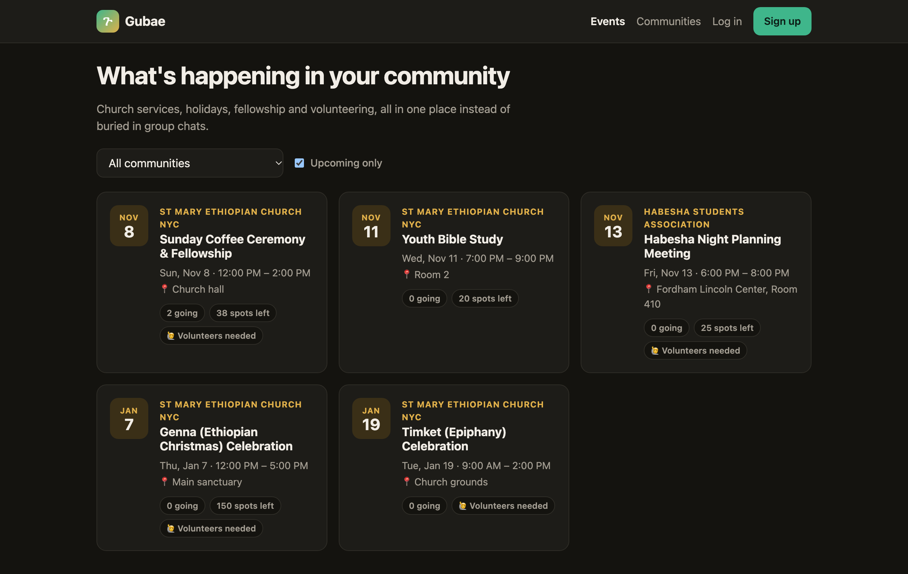
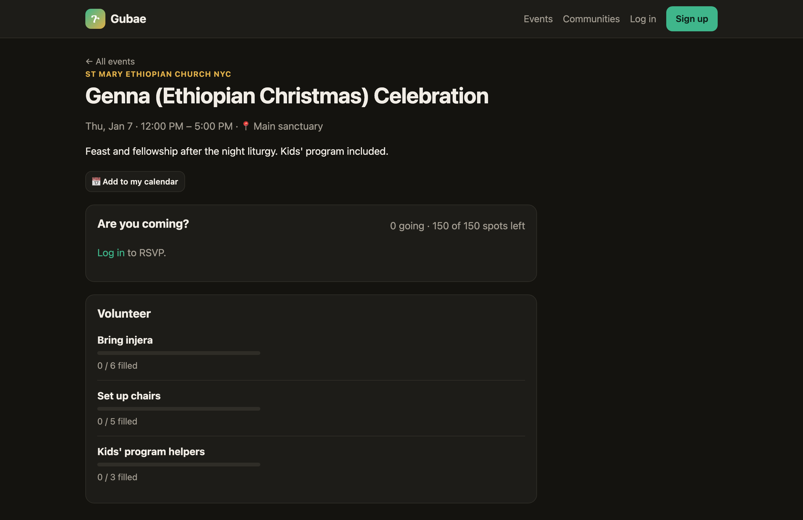
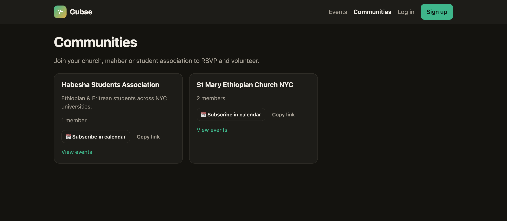

# Gubae (ጉባኤ)

**Events, RSVPs and volunteer sign-ups for church and community groups.**

Ethiopian churches, mahbers and student associations in the diaspora organize nearly everything through WhatsApp forwards: holiday services, coffee ceremonies, "who's bringing injera?". Announcements get buried, nobody knows how many people are coming, and the same three volunteers end up doing everything. Gubae gives each community one place where admins post events, members RSVP, and volunteer slots fill up visibly.



<table>
  <tr>
    <td width="50%"></td>
    <td width="50%"></td>
  </tr>
  <tr>
    <td align="center"><sub>Event page: RSVP, spots left, volunteer slots, add to calendar</sub></td>
    <td align="center"><sub>Communities: join, email settings, subscribe in your phone's calendar</sub></td>
  </tr>
</table>

## Features

- **Communities with roles.** Anyone can start a community and becomes its admin. Others join as members.
- **Events.** Admins create events with an optional capacity. Members see upcoming events and spots left.
- **RSVPs.** Going / Maybe / Can't go. Capacity is enforced safely under concurrent requests.
- **Volunteer slots.** "Bring injera (6 needed)". Members sign up, and progress bars show what's still needed.
- **Guest lists.** Admins only, for privacy.
- **Paste an announcement, get an event.** Admins paste the WhatsApp message they already wrote, and Claude fills in the event form (date, time, place, volunteer slots) for them to review.
- **People find out without opening the site:** an email to members when an event is posted (with a per-community opt-out), plus **calendar subscriptions**, so events appear in members' phone calendars automatically.
- **Reminder emails** the day before, with no duplicates (idempotent job).
- **JWT auth** with automatic token refresh, plus rate-limited login.

## Tech stack

| Layer | Tech |
|---|---|
| Backend | Python, Django 6, Django REST Framework |
| Auth | JWT (SimpleJWT): 15-min access tokens + 7-day refresh tokens |
| Database | SQLite in development, Postgres in production (set by environment variables) |
| Frontend | React 19, TypeScript, Vite, React Router |
| AI | Claude API (structured JSON output) for announcement → event drafts |
| Tests | 53 backend tests (permissions, capacity, auth, N+1 query guard, reminders, AI drafting with a mocked client, emails, calendar feeds) |

## Run it locally

**Backend** (terminal 1):
```bash
cd gubae
python3 -m venv .venv && source .venv/bin/activate
pip install -r requirements.txt
python manage.py migrate
python manage.py seed_demo        # demo users, communities, events
export ANTHROPIC_API_KEY=sk-ant-...   # optional: enables "paste an announcement"
python manage.py runserver        # http://127.0.0.1:8000  (admin at /admin)
```

**Frontend** (terminal 2):
```bash
cd frontend
npm install
npm run dev                       # http://localhost:5173
```

**Demo logins** (password `gubae-demo-2026`):
- `demo_admin`: admin of both communities (can create events, see guest lists)
- `demo_member`: member of St Mary (can RSVP and volunteer)

**Other commands:**
```bash
python manage.py test             # run the backend tests
python manage.py send_reminders   # email people going to events in the next 24h
```

## API

| Method | Endpoint | Who |
|---|---|---|
| POST | `/api/auth/register/` | anyone |
| POST | `/api/auth/token/` · `/api/auth/token/refresh/` | anyone |
| GET | `/api/auth/me/` | logged in |
| GET / POST | `/api/communities/` | read: anyone · create: logged in |
| POST / DELETE | `/api/communities/<slug>/membership/` | logged in (join / leave) |
| GET / POST | `/api/events/?community=&upcoming=true` | read: anyone · create: community admin |
| GET / PATCH / DELETE | `/api/events/<id>/` | read: anyone · write: community admin |
| POST / DELETE | `/api/events/<id>/rsvp/` | community member |
| GET | `/api/events/<id>/attendees/` | community admin |
| POST | `/api/events/<id>/volunteer-slots/` | community admin |
| POST / DELETE | `/api/volunteer-slots/<id>/signup/` | community member |
| PATCH | `/api/communities/<slug>/membership/` | member (email on/off) |
| POST | `/api/events/draft/` | community admin (AI; saves nothing) |
| GET | `/api/communities/<slug>/calendar.ics` · `/api/events/<id>/calendar.ics` | anyone (calendar apps) |

See [docs/DESIGN.md](docs/DESIGN.md) for architecture and design decisions.
